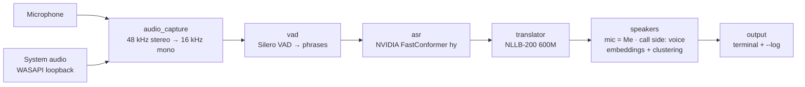

# Live Armenian → English call transcription

A Python terminal program for Windows that listens to **your microphone** and to **the other side of a call** (system audio) at the same time, transcribes spoken **Eastern Armenian**, translates it into **English**, and labels every line **Me / Speaker 1 / Speaker 2…** — typically 1.5–3 s after the speaker stops. Everything runs **locally on the CPU**: no cloud APIs, no paid tools, and no internet once the models are downloaded.

```
[00:00:03] Me   (latency 1.5 s)
HY: Ո՞ւր այցելեցիր արձակուրդների ընթացքում, քեզ դուրր եկավ այդ վայրը։
EN: Where did you go on vacation? Did you like it?

[00:00:09] Speaker 1   (latency 2.4 s)
HY: Կարծում եմ, ինչքան շատ ես ճամփորդում, դա ներդրում ա քո կրթության մեջ, դու ավելի ես աշխարհին այլ կերպ։
EN: I think the more you travel, the more investment you make in your education, the more different you become to the world.

[00:00:21] Speaker 2   (latency 2.9 s)
HY: Լինում, երեխաներ ես օգնում եմ հագնվել, նախաճաշել, պատրաստվել գնալ դպրոց…
EN: In Lynn, I help kids get dressed, have breakfast, get ready for school…
```
*(Illustrative layout: the Armenian and English lines are the program's real output on evaluation clips — my own voice and two public YouTube speakers; timestamps and latencies are typical values. The doubled `դուրր` and the invented "In Lynn" are real model errors — see [Known limitations](#known-limitations).)*

## Requirements

- Windows 10/11, **Python 3.11**, a 4-core CPU; tested on an Intel i5-1135G7 laptop with **8 GB RAM**, no GPU.
- **Latest Microsoft Visual C++ Redistributable (x64)** — older versions crash ONNX Runtime on import (D15).
- **Headphones** for the call: with speakers, the microphone also hears the other side (D3).
- About 2 GB of free RAM while running, and disk space for the models (kept in `models/` and the Hugging Face cache).

## Setup (once, with internet)

```powershell
py -3.11 -m venv .venv
.\.venv\Scripts\Activate.ps1
pip install -r requirements.txt
pip install -r requirements-benchmark.txt          # torch: needed only to convert the translation models
python scripts/convert_translation_models.py       # NLLB-200 (and OPUS-MT) → CTranslate2 int8 in models/
python -m app.main --download                      # speech, VAD and speaker models; then the program runs offline
```

## Usage

```powershell
python -m app.main --list-devices                  # numbers can change after replugging or reboot
python -m app.main --mic 12 --system 13            # 12 = microphone, 13 = headphones [Loopback]
python -m app.main --mic 12 --system 13 --log private/session.txt   # also save the transcript (UTF-8)
```

- `--system` must be the **[Loopback]** device of the output you hear the call on; a wrong device type fails with a clear message.
- Start the call app with output on the same headphones. Stop with **Ctrl+C**.
- **Timestamps** show when a phrase *started*; lines appear when processing *finishes*, so two lines can look slightly out of order when people talk at the same time (D28).
- `--debug` adds speaker similarity, recognition confidence, a time breakdown per line and memory use every 60 s. Tuning options (`--speaker-threshold`, `--max-phrase`, …) are listed by `--help`.
- If an audio device disappears (headphones unplugged), the program stops with `ERROR: Audio device stopped …` instead of going silent (D34): plug it back in, check the call app's output and restart.

## How it works



Both sources share one processing loop (D25). A phrase ends after 0.6 s of silence — or after a 0.15 s pause once it is longer than 6 s, with a hard cut at 10 s, so fast speakers still get short lines (D32). Each phrase is transcribed, translated and labelled; on the call side, its voice fingerprint is compared with every known speaker (cosine similarity ≥ 0.35 → same person, otherwise a new "Speaker N"; very short phrases go to the closest known speaker, D27).

| Module | Role |
|---|---|
| `app/audio_capture.py` | device list, WASAPI mic + loopback capture, lost-device check |
| `app/audio_utils.py` | stereo → mono, streaming 48 → 16 kHz resampling |
| `app/vad.py` | Silero VAD and phrase detection |
| `app/asr.py` | speech recognition |
| `app/translator.py` | translation (CTranslate2), loop protection (D33) |
| `app/speakers.py` | speaker embeddings and online clustering |
| `app/pipeline.py` | per-phrase processing, shared by the live program and replay |
| `app/output.py`, `app/main.py` | line format; command line, model loading, main loop |

## Models (all local) and why

Measured on this laptop with my own evaluation set (19 clips: own voice + YouTube; references written by me). Full numbers: [`DECISIONS.md`](DECISIONS.md), [`results/`](results/).

| Task | Chosen | Result | Rejected alternative |
|---|---|---|---|
| Speech → Armenian text | **NVIDIA FastConformer Armenian**, ONNX (`OpenVoiceOS/stt_hy_fastconformer_hybrid_large_pc_onnx`, via `onnx-asr`), fp32 | WER 23.8 % (mic 4.8 %, video 32.4 %), ≤ 0.24 s per clip, 715 MB | Whisper-large-v3-turbo-armenian: WER 48.5 %, 25–85 s per clip, 3.65 GB, repetition hallucinations (D19) |
| Armenian → English | **NLLB-200 distilled 600M**, CTranslate2 int8 | chrF 62.5, ~1.2 s per sentence, 1.3 GB | OPUS-MT hy→en: chrF 43.6 on recognised text, reversed meanings (D22) |
| Phrase detection | **Silero VAD** (ONNX) | < 1 ms per 32 ms frame | volume threshold, WebRTC VAD (D23) |
| Speaker labels | **WeSpeaker ResNet34-LM** (ONNX, 26.5 MB) + online clustering | 2 friends on a real call: 0 merges, labels stable | PyTorch-based models (too heavy, D26) |

**Licence note:** NLLB-200 is **CC-BY-NC-4.0 (non-commercial)** — fine for this challenge, not for a commercial product (OPUS-MT, Apache-2.0, would be the fallback). WeSpeaker model: CC-BY-4.0.

## Measured performance

| | Result |
|---|---|
| Latency (end of phrase → English line) | two live calls with 2 friends on Google Meet (5 + 6 min, 120 lines): **median 2.1–2.8 s**; worst 4.7 s in the first, 5.3 / 5.8 s for 2 long phrases in the second (busy CPU) — target ≤ 5 s |
| Memory | program 1.6–1.9 GB; with Meet + camera the 8 GB laptop is at 88–96 % but stable (sessions of up to 6 min tested) |
| Offline | works with Wi-Fi off |
| Robustness | silence on one side never blocks the other; translation loops prevented (worst 3.1 s instead of 28 s, D33); lost device → clear error |

Details and the full test list: [`TESTS.md`](TESTS.md).

## Known limitations

- **Recognition** is good on clear speech (mic WER 4.8 %) but much weaker on fast, natural call/podcast speech (~32–41 % WER). Proper names, rare and English/Russian words mixed into Armenian, and short colloquial words are often wrong. The model sometimes **doubles a syllable** (`Շատատ`, `դուրր`) — a property of the model, not of the audio path (D35). Splitting speech into phrases costs ~2 WER points at phrase boundaries.
- **Translation** can be **fluent but wrong** ("In Lynn" above), and very short phrases lack context (`Այո` → "Yes, I did."). The Armenian line is always shown so the original can be checked.
- **Speakers:** very short phrases are assigned to the closest known voice and can be wrong; noise or a short odd phrase can occasionally create an extra "Speaker N". Labels start over at every run.
- **Latency** is usually 2–3 s, but when the CPU is busy (call app with camera, browser) a long phrase (7–10 s of speech) can take 5–6 s — 2 of 65 lines in a 6-minute rehearsal. Closing other heavy apps helps.
- **Audio setup:** headphones are required. If they are unplugged, Windows plays the call through the laptop speakers and the microphone can pick it up as "Me"; the program stops with an error and must be restarted.
- **Scope:** Eastern Armenian only; the evaluation set is small (19 clips + 2 recorded calls), so all numbers are indicative.

## With more time

- Better recognition of conversational speech: the model's Transducer decoder (not in the ONNX export) or fine-tuning on call-quality Armenian audio.
- Translation with the previous sentence as context, or the larger NLLB 1.3B (needs more than 8 GB RAM to convert and run comfortably).
- Automatic reconnect when a device returns (D34), and echo cancellation so speakers can be used instead of headphones.
- A longer, more diverse evaluation set (more speakers, real call recordings with references).

## Repository

```
app/          the program
evaluation/   benchmarks and analysis: ASR, translation, speakers, replay of recordings, settings comparisons
scripts/      model conversion, recording evaluation clips, audio capture test
tests/        unit tests:  python -m pytest -v
eval/         references (audio files are not committed)
results/      benchmark results
```

`python -m evaluation.replay --mic file.wav --system file.wav` runs the full pipeline on recordings instead of live devices. Design decisions with alternatives and measurements: [`DECISIONS.md`](DECISIONS.md); plan and working rules: [`PLAN.md`](PLAN.md), [`CLAUDE.md`](CLAUDE.md).
